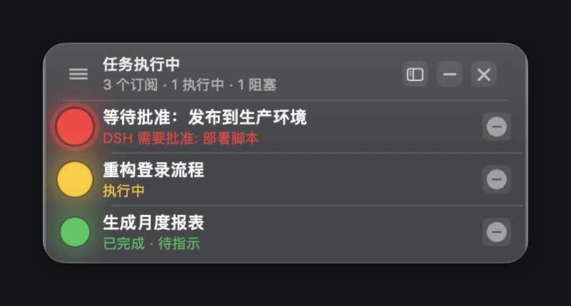
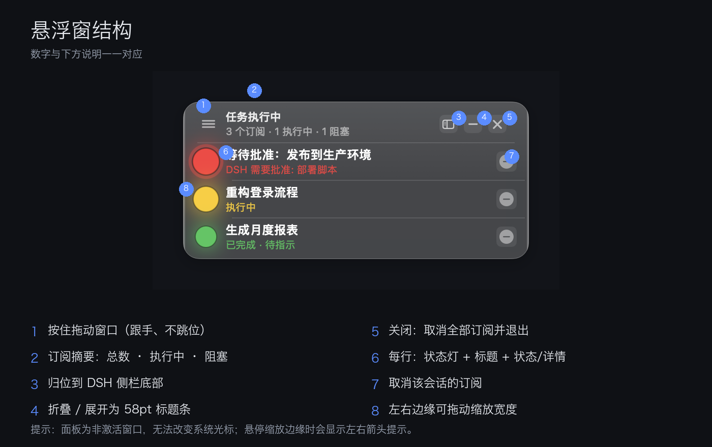
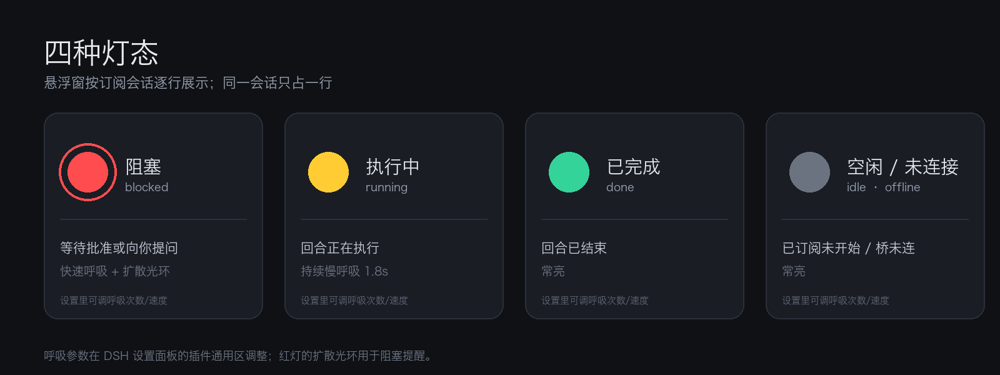
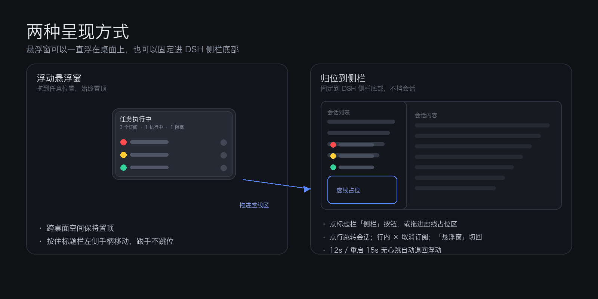
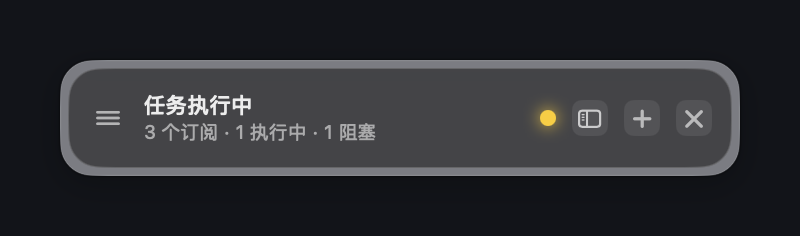
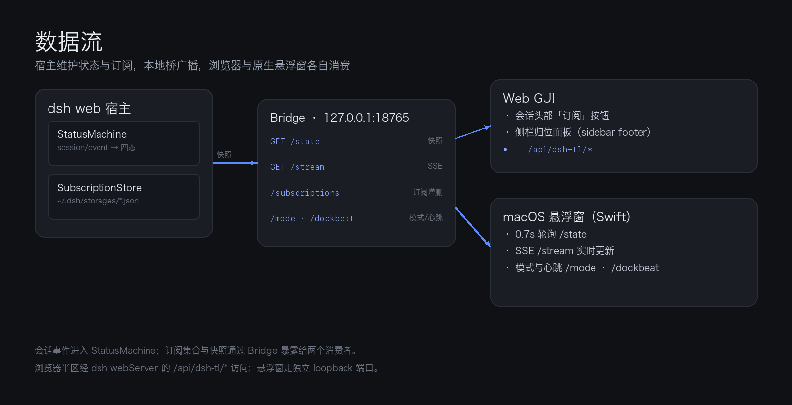

# dsh-trafficlight — DSH 任务状态红绿灯

> **Fork notice：** 本仓库是面向 DSH Desktop `0.2.2-rc.3` 适配的 fork，新增了归位模式、原生
> Liquid Glass、持续呼吸与一整套交互修复。改动明细见 [FORK-NOTES.md](./FORK-NOTES.md) 和
> [docs/LOCAL-PATCHES.md](./docs/LOCAL-PATCHES.md)，上游 PR 见
> [pull #1](https://github.com/erinwangstudio-art/dsh-trafficlight/pull/1)。

在 DSH 里**订阅会话**，红/黄/绿三色灯就会逐行显示每个会话的任务状态：等待批准的亮红灯、
执行中的亮黄灯、完成的亮绿灯。灯既可以浮在桌面最上层，也可以固定到侧栏底部。



## 一眼看懂



- **标题栏**：拖动柄、订阅摘要（总数 / 执行中 / 阻塞）、归位、折叠、关闭。
- **每一行**：状态灯 + 会话标题 + 状态和阻塞详情；行末按钮只取消这一条订阅。
- **订阅制**：只显示你主动订阅的会话，列表持久化，重启 DSH 后保留。
- **两种形态**：浮动窗始终置顶；归位后面板固定在 DSH 侧栏底部，不再遮挡会话。

## 快速开始

```bash
# 1. 安装插件（按你的 profile 调整 desktop / web）
dsh plugin --profile desktop add https://github.com/NgoChingYee/dsh-trafficlight.git
# 如果当前 DSH 版本不支持 Git 安装，先从仓库根目录本地安装：
# dsh plugin --profile desktop add /path/to/dsh-trafficlight

# 2. 重启 DSH（Desktop 直接退出重开；命令行 profile 用 dsh web）
```

> 从 GitHub 安装会执行仓库里的构建产物（`lib/` 和 overlay 二进制已随仓库提交）；
> 本机工具链与二进制架构不一致时，按下面的「从源码构建」重新编译。

重启后：

1. 打开任意会话，点会话头部的「🚦 订阅」；
2. 悬浮窗会自动出现（首次订阅时拉起；DSH 重启且存在订阅时自动恢复）；
3. 再点一次「已订阅」即取消订阅。

> 订阅按钮每 2 秒同步一次，所以从悬浮窗或侧栏面板里取消订阅，头部状态也会跟着更新。

## 四种灯态



| 灯 | 状态 | 触发条件 |
|---|---|---|
| 🔴 红 | `blocked` | 等待批准，或向你提问（`ask_user_question`） |
| 🟡 黄 | `running` | 回合正在执行；持续慢呼吸 |
| 🟢 绿 | `done` | 回合已结束 |
| ⚪ 灰 | `idle` / `offline` | 已订阅未开始 / 桥未连接 |

红灯会快速呼吸并向外扩散光环；呼吸次数和速度可在 DSH 设置面板调整。

## 两种呈现方式



**浮动悬浮窗**：默认形态，始终置顶、跨桌面空间，位置会被记住。

**归位到侧栏**：点标题栏「侧栏」按钮，或把悬浮窗拖进侧栏底部的虚线占位区。归位后：

- 常驻虚线占位不遮挡会话列表；
- 点行即可跳转到对应会话，行内 ✕ 取消订阅，点「悬浮窗」切回浮动；
- 12 秒（归位时）/ 15 秒（重启后）没有心跳会自动退回浮动，避免灯丢失。

## 交互速查

| 想做的事 | 操作 |
|---|---|
| 移动窗口 | 按住标题栏左侧 ⠿ 拖动（按指针位移，跟手不跳位） |
| 调整宽度 | 拖左右边缘；悬停时边缘亮起并显示 ↔ 提示 |
| 收起 / 展开 | 标题栏「−」/「+」，收成 58pt 的标题条 |
| 归位 / 取回 | 标题栏「侧栏」按钮，或拖进侧栏底部虚线区；侧栏面板点「悬浮窗」取回 |
| 取消一条订阅 | 浮动窗行末 ⊖ / 侧栏面板行末 ✕ |
| 关闭红绿灯 | 标题栏 ✕ = 取消全部订阅并退出；只想暂时隐藏用菜单栏「🚦 → 隐藏悬浮窗」 |
| 菜单栏 | 查看聚合状态、显示 / 隐藏悬浮窗、退出 |

折叠后只保留一条 58pt 标题栏，状态灯和计数仍然可见：



> 面板是**非激活窗口**（不抢焦点），macOS 不会为它改变系统光标，因此缩放边缘用绘制的
> 高亮条 + ↔ 徽章提示，而不是鼠标指针变化。

## 设置

在 DSH 设置面板的插件通用区：

- **悬浮窗不透明度**：控制玻璃浓度（越透越清亮，越浓越磨砂）；
- **极简模式**：只显示拖动柄、关闭按钮和一个跟随「最近一次更新」的大信号灯；
- **呼吸次数 / 速度**：控制状态切换时的强调脉冲。

## 架构



- **宿主**：`session/event` → 每会话四态；订阅集合持久化在 `~/.dsh/storages/`。
- **Bridge**：`127.0.0.1:18765` 上的仅本机服务——`GET /state`、`GET /stream`（SSE）、
  订阅增删、`/mode` 与 `/dockbeat`；浏览器半区走 dsh webServer 的 `/api/dsh-tl/*`。
- **两个消费者**：Web GUI（会话头部订阅按钮 + 侧栏归位面板）和 Swift 悬浮窗
  （0.7s 轮询 + SSE）。两边共享同一份订阅与状态。
- 除 Node 内置模块和 AppKit/SwiftUI 外没有额外运行时依赖。

## 从源码构建

```bash
# 宿主 + 浏览器半区
npm install
npm run build

# macOS 悬浮窗（Swift 6.4 / macOS 13+）
cd overlay
bash build.sh
```

> `build.sh` 会自动处理两个本机坑：SwiftPM 的沙箱（加 `--disable-sandbox`）和
> SDK / 编译器版本不匹配（默认切到 `MacOSX15.4.sdk`，可用
> `DSH_TL_OVERLAY_SDKROOT` 覆盖）。也可以手动用临时 SwiftPM 布局编译，见
> [docs/LOCAL-PATCHES.md](./docs/LOCAL-PATCHES.md)。

> **构建提示**：官方 `pnpm install` 依赖的 `@deepseek-ai/dsh-client-runtime@^0.1.5-rc.1`
> 在公共源可能不存在，本机若因此失败，可参考 [FORK-NOTES.md](./FORK-NOTES.md) 用本地
> DSH 运行时构建，或直接使用仓库中已构建的 `lib/` 与 overlay 二进制。
> SwiftPM 产出的是裸可执行文件（非 `.app`），`setActivationPolicy(.accessory)` 让它表现为
> 无 Dock 图标的菜单栏 agent；`overlay/Info.plist` 已含 `LSUIElement`，需要 `.app` 时可用
> Xcode 打开。

**调试用 mock 桥**（不启动 DSH 也能预览）：

```bash
node mock-bridge.mjs          # 3 个演示会话循环 running / blocked / done
bash scripts/trafficlight.sh  # 启动悬浮窗（自动重编；--restart 强制重启）
```

## 兼容性

| 插件 | DSH | 说明 |
|---|---|---|
| **0.4.0-fork.1**（当前） | DSH Desktop `0.2.2-rc.3`、dsh web `0.1.5-rc.1` | 客户端以 scoped 包名注册，需要 `dsh-client-locale` / `dsh-client-ui-conversation` 槽位宿主 |
| 0.3.x | dsh `0.1.x` web profile | 无归位 / 玻璃 / 呼吸特性 |

## 已知限制

- **会话侧栏「…」菜单不可扩展**：`dsh-client-ui-workspace` 里是硬编码菜单，所以订阅入口
  放在官方槽位 `conversation.session.header.actions`（会话头部操作行）。
- **非激活窗口无法改变系统光标**：改用绘制的边缘高亮与 ↔ 提示（见上）。
- **仓库内的 overlay 二进制**为 arm64、macOS 13 构建；其他架构/系统请自行编译。
- 仅支持 macOS（悬浮窗依赖 AppKit / SwiftUI）。

## 目录结构

```
dsh-trafficlight/
├── src/
│   ├── index.ts                  # apply(ctx)：火流 + 桥 + 页内路由
│   ├── core/types.ts             # 前后共享 wire 类型
│   ├── host/
│   │   ├── status.ts             # 状态机：session/event → 四态 + 聚合 + 标题
│   │   ├── subscriptions.ts      # 订阅集合 + 持久化
│   │   ├── overlay-launcher.ts   # 订阅时自动拉起悬浮窗
│   │   ├── settings.ts           # 透明度 / 极简模式 / 呼吸参数 / 呈现模式
│   │   └── bridge.ts             # loopback 桥 (18765) + /api/dsh-tl/*
│   └── client/index.tsx          # 订阅按钮 + 侧栏归位面板
├── overlay/                      # 原生 macOS 悬浮窗（Swift）
│   ├── TrafficLightApp.swift     # 面板/拖动/缩放/折叠/归位
│   ├── TrafficLightWindow.swift  # 透明置顶 NSPanel + Liquid Glass
│   ├── TrafficLightView.swift    # 多行灯列表 + 折叠条
│   └── StatusClient.swift        # 轮询桥 → @Published 快照
├── images/                       # README 图示
├── docs/LOCAL-PATCHES.md         # 完整补丁与排查记录
├── mock-bridge.mjs               # 无 DSH 时的演示桥
└── scripts/trafficlight.sh       # 一键启动悬浮窗
```

## 许可证

[MIT](./LICENSE)
